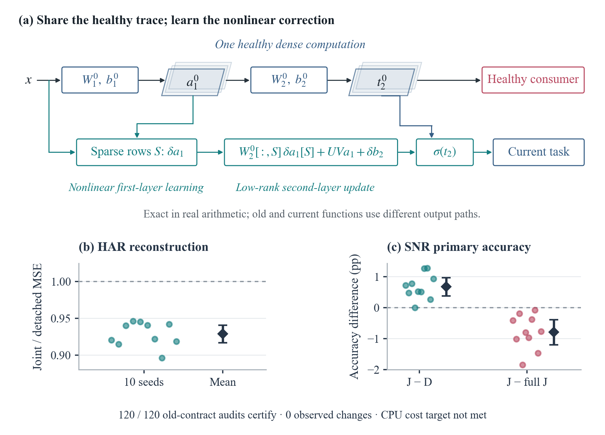
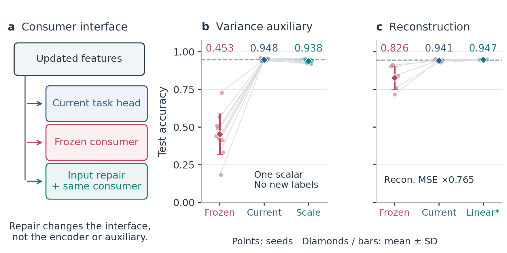

# RepFix

**Silent Scale Shift: When Shared Updates Break Existing Readouts**

This artifact accompanies the 81-page manuscript in
[`paper/RepFix_ICLR2027.pdf`](paper/RepFix_ICLR2027.pdf), with nine main-text pages.
It contains the source, complete recorded outcomes, analysis and figure scripts,
fixed study protocols, and structural checks.

The paper separates task decodability from compatibility with an existing readout.
Matched continuation and input repair isolate a scale-sensitive failure. Signed
update audits examine the diagnostic, while the SNR confirmation and single-encoder
controls measure the benefit and cost of preserving compatibility. The artifact
retains the CNN, frozen-trunk, nonlinear-side, and pretrained vision boundary results.
A new confirmation on ten fresh HAR training seeds meets the fixed joint
criterion for reconstruction progress, primary noninferiority, bounded legacy
decision changes and native float32 serving cost. The direct head and its
training-only OLS reader both certify 10/10 under the primary monitor; the logit
map certifies 9/10. The earlier HAR 9/10 and unsuccessful SNR studies remain
separate. See [the fresh confirmation report](docs/FRESH_CONFIRMATION_20261110.md)
and [the earlier audit](docs/PROTECTED_HEAD_AUDIT_20261109.md) for methods and scope.

The final matched completion adds a competitive full-feature alignment control,
complete OLS baselines and correct/wrong decision flows. Classification agreement
does not retain either fixed selective consumer for auxiliary-learning readers.
A distinct-consumer ResNet screen stops at its utility/numerical gates, without
opening the official test split. See [the final review](docs/FINAL_REVIEW_20261110.md)
and [reading guide](docs/REVIEWER_GUIDE.md) for the supported claims and open gaps.


The shared-replay study adds an exact two-version computation and 20 fresh
HAR/SNR runs: HAR reconstruction MSE is 0.929 of detachment; SNR primary gain
is +0.678 points [0.383, 0.973]. All 120 class/selective contract audits certify
with zero observed changes. SNR still loses 0.792 points to unrestricted joint
training, CPU cost exceeds budget, and both fixed ResNet capacity screens stop
before official test scoring. [The assessment](docs/FINAL_REVIEW_20261110.md)
separates this partial frontier from a complete deployment claim.



## Paper and downloads

- [Read the final paper](paper/RepFix_ICLR2027.pdf) — 9 main pages, 82 pages total.
- [Download supplementary material](artifacts/2026-11-10/RepFix_SharedReplay_20261110_supplement.zip)
- [Download manuscript source and evidence](artifacts/2026-11-10/RepFix_SharedReplay_20261110_source.zip)
- [Reproduction guide](docs/REPRODUCIBILITY.md) · [Evidence index](docs/EVIDENCE_INDEX.md)



## Start here

From this directory, verify the extracted files and archived source/protocol links:

```text
python repro/scripts/verify_supplement.py
```

This first check uses the Python standard library and reads the shipped manifest.
It does not download data or train a model.

For the structural tests, figure reconstruction, and manuscript build:

```text
python -m pip install -r requirements-review.txt
python repro/scripts/verify_supplement.py --tests --figures --paper
```

The optional checks run in a temporary copy, leaving the extracted release intact.
The paper build also requires `pdflatex`, `bibtex`, and `pdftotext` on `PATH`.
See [the reproduction guide](docs/REPRODUCIBILITY.md) for each check and its inputs.

## Find the evidence

- [Evidence index](docs/EVIDENCE_INDEX.md): manuscript figures and claims mapped to
  recorded results, analysis scripts, and fixed protocols.
- [`repro/results/CPUCONT/`](repro/results/CPUCONT/): paired continuation, repair,
  real reconstruction, CNN, head-state, protected-benefit, compiled, nonlinear, chart, vision, and protected-head
  studies. Frozen development choices and the exact-count correction are included.
- [`results/README.md`](results/README.md): detailed directory map for historical
  benchmarks; [`repro/README.md`](repro/README.md): current script entry points.
- [`docs/plans/`](docs/plans/): study protocols. Plans referenced by recorded hashes
  are retained byte for byte.
- [`paper/figures/`](paper/figures/): vector figures and editable SVG counterparts.

## What can be reproduced

The archive supports dataset-free file/provenance checks, 91 focused structural
tests, reconstruction of all 23 included figures from recorded results, and a local
LaTeX build. The validation choice and failed nonlinear development gate can be
inspected without rerunning training.

Raw datasets and trained tensor checkpoints are not included. Training and an
independent replay of saved model states require those additional inputs; shipped
replay records document the earlier completed checks. Dataset setup is described
in [the reproduction guide](docs/REPRODUCIBILITY.md#data-and-training).
Historical aggregate-only results are identified in `results/README.md`.

`ARTIFACT_MANIFEST.json` records the manuscript hash and a SHA-256 digest for every
payload file. `REVIEW_CHECKS.json` records the checks performed on this release.
The MIT license and third-party terms are in [`LICENSE`](LICENSE) and
[`THIRD_PARTY_NOTICES.md`](THIRD_PARTY_NOTICES.md). Citation metadata is in
[`CITATION.cff`](CITATION.cff).
