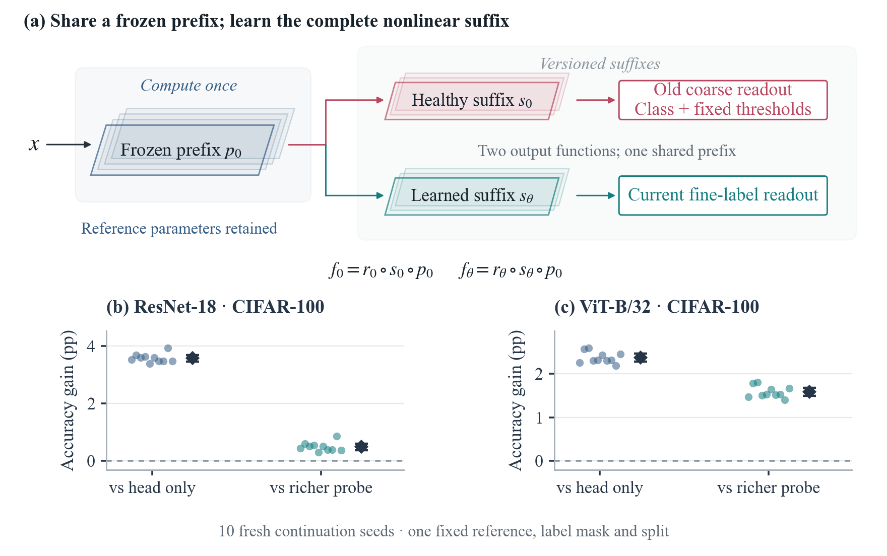

# RepFix

Silent Scale Shift: When Shared Updates Break Existing Readouts

This repository contains the manuscript, editable figures, numerical records,
fixed study plans and verification scripts.

An update can improve a task while breaking an existing readout. Matched
continuation and unlabeled repair isolate one scale mechanism. The serving
studies measure which class and threshold decisions survive and how much
computation the protected program uses.

Cross-view auxiliary training on CIFAR-100 improves ViT-B/32 accuracy by
0.84 percentage points [0.66, 1.03] over matched supervised continuation
and lowers held-out contrastive loss by 19.5%. Twelve continuations span
four fitted references with shared ImageNet pretraining. The FP32 reference
preserves every audited old decision. The selected lower-precision reference
changes at most 0.18% of decisions. [Visual auxiliary results](docs/CONTRASTIVE_RESULT_20261111.md)

The full 24-endpoint control matrix compares the same twelve joint runs
against two-view and doubled-epoch supervised continuation. At the same
suffix-forward budget, the gains are 0.725 points [0.286, 1.164] and
0.527 points [0.195, 0.858]. [Training-work controls](docs/COMPUTE_CONTROL_RESULT_20261111.md)

The fixed recipe also improves accuracy with AugReg ViT-B/32 weights
by 0.60 points [0.15, 1.05] and lowers contrastive loss by 8.46%.
The retained FP32 reference preserves every audited AugReg decision.
On the TorchVision endpoints, a BF16 reference with the same FP32 current
graph costs 1.078× [1.069, 1.088] at batch 128.
[Checkpoint replication](docs/CHECKPOINT_REPLICATION_20261111.md)

The earlier supervised-transfer studies and the failed visual reconstruction
and routing screens document how the result depends on the task and access
conditions. [Earlier experiments](docs/FOLLOWUP_REPORT_20261110.md)



Cached fitting anchors also support disagreement forecasts through ridge
leave-one-out residuals. Exact certification uses an independently sampled
monitor. [Risk estimation and audit results](docs/CACHED_RISK_RESULT_20261111.md)

## Paper and files

- [Paper](paper/RepFix_ICLR2027.pdf)
- [Supplementary archive](artifacts/2026-11-11/RepFix_ComputeControls_20261111_supplement.zip)
- [Editable source](artifacts/2026-11-11/RepFix_ComputeControls_20261111_source.zip)
- [Reading guide](docs/REVIEWER_GUIDE.md) · [Evidence index](docs/EVIDENCE_INDEX.md)
- [Final argument and English](docs/STORY_FINAL_20261110.md) · [Scientific integrity](docs/STORY_INTEGRITY_20261110.json)
- [Editorial and figure refinement](docs/EDITORIAL_FINISH_20261110.md) · [Integrity checks](docs/EDITORIAL_VISUAL_VERIFICATION_20261110.json)

## Verify the artifact

```text
python repro/scripts/verify_supplement.py
```

The default check uses the standard library to verify files, numerical records,
source/plan hashes, frozen choices and recorded outcomes. For the optional CPU
checks, install the review environment and run:

```text
python -m pip install -r requirements-review.txt
python repro/scripts/verify_supplement.py --tests --figures --paper
```

This runs in a temporary copy and preserves the extracted source. It checks 142
focused structural tests, reconstructs 29 manuscript figures from recorded data,
and compares the rebuilt paper's page text and pixels. LaTeX requires `pdflatex`,
`bibtex` and `pdftotext`. See the [reproduction guide](docs/REPRODUCIBILITY.md).

## Evidence and training

- [`repro/results/CPUCONT/`](repro/results/CPUCONT/): complete continuation,
  repair, distillation, nonlinear-scope and actual-serving records.
- [`docs/plans/`](docs/plans/): fixed protocols and byte-preserved historical versions.
- [`repro/scripts/`](repro/scripts/): numerical drivers, local analysis, plots and verification.
- [`paper/figures/`](paper/figures/): publication-width vector PDF/SVG and PNG previews.
- [`repro/source_versions/`](repro/source_versions/): exact executed source snapshots.
- [Historical result map](results/README.md) · [Current script entry points](repro/README.md)

Raw datasets, official weight files, trained tensors and large representation
caches are outside the compact archives. Recovered tensor and output checks are
recorded explicitly; the default verifier does not silently rerun a pretrained
backbone or claim to load those excluded inputs. The numerical CPU environment
and hardware are separate from the lightweight local review environment.
